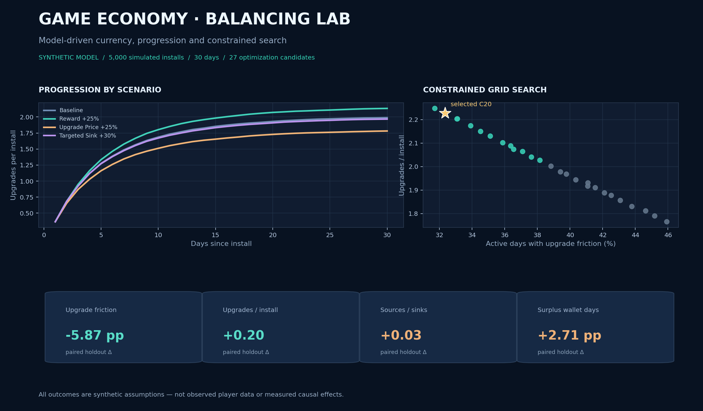
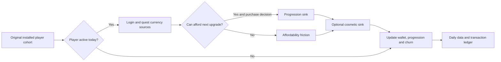

# 🎮 Game Economy Simulator & Optimizer

> **Design, simulate, audit, and optimize a synthetic F2P soft-currency economy.**
>
> For Game Economist, Economy Designer, Product Analyst, Game Economy Analyst, and Technical Game Operations interviews. **This is a reproducible project using hypothetical player behavior, not a live-game analysis or an empirical monetization study.**



## Project at a glance

| Capability | Implemented feature | Where to see it |
|---|---|---|
| Economy engineering | Soft-currency rewards, optional sinks, escalating progression costs | `src/economy.py` |
| Player segmentation | Casual, Regular, Engaged synthetic behavior patterns | `data/persona_metrics.csv` |
| Scenario design | 4 policies across one 5,000-install, 30-day cohort | `data/scenario_summary.csv` |
| Event instrumentation | **356,357** synthetic player actions and currency transactions | `data/events_sample.csv` (full log and database regenerated locally) |
| SQL analysis | 6 reproducible SQLite queries | `sql/`, `reports/sql_outputs/` |
| Accounting checks | Every wallet reconciles to initial coins plus ledger transactions | `sql/04_wallet_reconciliation.sql` |
| Optimization | 27 parameter combinations with constraints and Pareto analysis | `src/optimize.py` |
| Robustness checks | Separate 4-seed holdout, assumption stress tests, and archetypes | `data/optimizer_validation_summary.csv` |
| Storytelling | Browser-viewable interactive dashboard, Excel scorecard, decision memo | `reports/` |
| Testing | 20 automated checks at release | `tests/` |

## Business question

**Can we reduce moments when active players cannot afford their next progression upgrade, while preserving upgrade throughput and avoiding excessive virtual currency accumulation?**

The model exposes three levers—quest rewards, progression prices, and optional cosmetic purchase propensity—and monitors economic stability with explicit sources/sinks accounting. The modeling architecture is deliberately game-agnostic: the same questions arise in progression-heavy casual, collection and strategy games, although their actual rules and parameters differ.

### The synthetic 30-day loop



Every day is deterministic conditional on a random seed and the stored behavioral assumptions. The model is not designed to copy any commercial title.

## Illustrative model outcome (holdout seeds, not empirical uplift)

A fixed 27-candidate training grid selected **candidate C20**: quest reward ×1.10, upgrade price ×0.85, optional cosmetic purchase propensity ×1.30. Four different random seeds were reserved for holdout checks.

| Metric | Baseline | Selected C20 | Paired difference |
|---|---:|---:|---:|
| Upgrade affordability gap, active play-days | 37.31% | 31.44% | **−5.87 pp** |
| Upgrades / original install | 2.016 | 2.213 | **+0.197** |
| Median coins among Day-30 survivors | 160.0 | 144.4 | −15.6 |
| Soft currency sources / sinks | 1.042 | 1.076 | **+0.034 (worse)** |
| Surplus wallet play-days | 1.39% | 4.10% | **+2.71 pp (worse)** |
| Exact-day D7 return | 25.87% | 25.86% | −0.01 pp |

**Not an unconditional win:** The selected configuration makes progression more accessible **but increases the frequency of surplus-wallet states and raises the source/sink ratio.** An actual economy designer would need additional constraints, observed player data, and product-specific goals before recommending deployment. Retention appears almost unchanged partly **because the churn response to the economy is weak by construction**. Do not interpret that as a real-world effect.

Read the [decision memo](reports/decision_memo.md) for a full discussion of tradeoffs and limits. The [model card](docs/MODEL_CARD.md) defines every assumption, metric denominator, rule and selection criterion.

## Dashboards and artifacts

**1. Interactive dashboard — HTML:** Open [`reports/interactive_dashboard.html`](reports/interactive_dashboard.html) in a browser. Includes four sections: economy trends, optimization frontier, personas and archetypes, and model stress tests. Charts load Plotly from a public CDN, so an internet connection is required to display interactive plots.

**2. Excel analysis workbook:** Open [`reports/Economy_Scenario_Workbook.xlsx`](reports/Economy_Scenario_Workbook.xlsx). Contains a formula-driven executive scorecard, original scenario results, the 27 candidates, persona comparisons, two daily trend charts, and ledger audit summary. **The Excel sheet is a snapshot**; changing spreadsheet cells does not run the Python model.

**3. Live what-if sandbox (optional):** Run `streamlit run app.py` to change economic levers and compare the resulting two synthetic worlds interactively.

## Reproduce locally

Use **Python 3.10+**:

```bash
python -m venv .venv
# Windows: .venv\Scripts\activate
# macOS/Linux: source .venv/bin/activate
pip install -r requirements.txt

python -m src.run_analysis
python -m src.build_dashboard
python -m src.build_memo
python -m pytest -q
```

The public GitHub bundle includes compact tables, a 1,000-event sample, the HTML dashboard and the Excel workbook. The full event log (`data/events.csv`, 356,357 rows) and SQLite database (`data/game_economy.sqlite`) are deliberately **not committed** because they are large, fully regenerable outputs. Run `python -m src.run_analysis` to create them. You **do not need Python just to browse the included dashboard and tables**.

Optional interactive sandbox:

```bash
pip install streamlit
streamlit run app.py
```

Optional workbook regeneration requires the separate `artifact_tool` spreadsheet environment; the included XLSX is already fully populated.

**What is reproducible?** Every synthetic player's decisions, the scenario outputs, the training grid, the holdout comparisons, SQL ledger checks and assumption stress cases, given compatible NumPy/Pandas versions and the recorded seeds. The workbook and dashboard are report renderings of those outputs.

## Key folders

```text
Game-Economy-Simulator-and-Optimizer-/
├── README.md
├── app.py                        optional interactive what-if sandbox
├── config/                       scenarios and three illustrative economy profiles
├── src/
│   ├── economy.py                vectorized player simulator and event ledger
│   ├── optimize.py               predeclared grid, guardrails, holdout validation
│   ├── run_analysis.py           pipeline: CSV + SQLite + SQL + optimization + stresses
│   ├── build_dashboard.py        interactive HTML (requires Plotly CDN)
│   ├── build_memo.py             decision memo
│   ├── build_workbook.py         optional Excel snapshot exporter
│   └── run_simulation.py         quick legacy scenario-only CLI
├── sql/                          6 SQLite analytical queries
├── data/                         compact outputs + event sample (large files regenerate locally)
├── reports/
│   ├── preview.png
│   ├── interactive_dashboard.html
│   ├── Economy_Scenario_Workbook.xlsx
│   ├── decision_memo.md
│   ├── optimization_selection.json
│   └── sql_outputs/              6 query result CSVs
├── docs/
│   ├── MODEL_CARD.md
│   ├── SQL_ANALYSIS_GUIDE.md
│   └── INTERVIEW_WALKTHROUGH.md
└── tests/                         model, ledger, SQL and optimization checks
```

## Public repository versus full local bundle

This GitHub version intentionally **tracks source code, config, tests, small output tables, the Excel report, the CDN-based interactive dashboard and sample events**, while excluding the large generated full event CSV and SQLite database. They are rebuilt from source with `python -m src.run_analysis`. The separately packaged local V2 ZIP may contain these large outputs, but they are not required to review the work on GitHub.

## Methodology and integrity

- **Event-level audit:** The SQL database contains four scenarios × 5,000 original installs, with separate log records for login, quest, progression, cosmetics and churn. Every synthetic currency balance satisfies: `ending_wallet = starting_wallet + sum(event coin deltas)`.
- **Fixed cohort metrics:** Exact-day D7 return uses active players on Day 7 divided by **all original installs**, not surviving players. Upgrade affordability is a property of *active play-days*, not a user survey or proof of wanting to purchase.
- **Scenario comparability:** Pseudorandom opportunities are shared where possible across baseline and policy variants. Shared seeds reduce scenario noise but **do not identify causal effects**.
- **Optimization discipline:** 27 fixed policy candidates are evaluated on four training seeds. Selection uses documented guardrails and a transparent heuristic score. Holdout results use four **disjoint** seeds and are never part of candidate selection. Holdout seed variability is not a player-population confidence interval.
- **Scope limits:** One soft currency, no monetized/premium economy, no real purchase events, no empirical price elasticity, no live A/B test, no causal uplift estimates, no licensed game assets.

See [the full model card](docs/MODEL_CARD.md) and [SQL audit guide](docs/SQL_ANALYSIS_GUIDE.md). An [interview walkthrough outline](docs/INTERVIEW_WALKTHROUGH.md) is provided separately from the technical build.

## Technical background references

- Unity — [Building an in-game economy](https://unity.com/how-to/building-game-economy-guide-part-2): sources, sinks and progression design.
- Unity — [Designing a balanced in-game economy](https://activation.unity3d.com/how-to/design-balanced-in-game-economy-guide-part-3): segment differences, player journey and experimentation.
- GameAnalytics — [Metrics](https://docs.gameanalytics.com/events-metrics-and-filtering/metrics/): strict exact-day cohort return conventions.

**This repository is an original, educational exercise and is not affiliated with these organizations or a real game company.**
